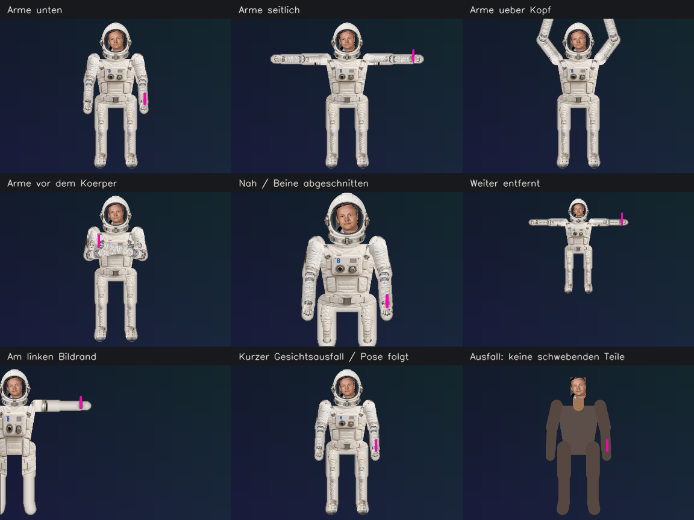
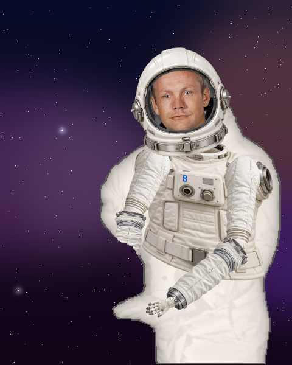

# EVA-Raumanzug: Implementierung und Überprüfung

Der vorhandene Anzug wurde im Branch `codex/37-realistic-eva-suit` auf Basis von
`main` / `a7c2887` weiterentwickelt. Die allgemeinen Review-Fixes und das vorhandene
Lichtschwert bleiben erhalten. Acht getrennte fotorealistisch gestaltete PNG-Teile
folgen einem lokal erkannten Körper-Rig. Ein eigener Halsring, Schulterpolster,
Gelenkbereiche, Handschuhe, Stiefel und das Brustmodul ergänzen den Stoffunterbau.
Das Gesicht stammt aus dem aktuellen Original-Kamerabild und bleibt im Visier
sichtbar; es ist in keinem Asset enthalten.

## Start

Im Ordner `fruit-ninja-cv`:

```powershell
python -m pip install -r requirements.txt
python tools/prepare_suit.py --all-models
python main.py --suit-diagnostics
```

Für eine getrennte Installation davor optional `python -m venv .venv` und unter
Windows `.venv\Scripts\Activate.ps1` verwenden. Die Pose-Modelle werden nur einmal
geladen; der Installer kann mit `--offline` ausschließlich lokale Dateien prüfen.
Im Menü `Hintergrund: YOLO` wählen, um ohne grüne Wand oder Referenz zu spielen.
Bei `Normal` wie bisher `b` drücken und für die leere Referenz aus dem Bild treten.
Bei `Aus` ist der Anzug bewusst aus. `q` beendet das Spiel, `d` zeigt die Stiftmaske.

`--suit-diagnostics` schreibt alle fünf Sekunden tatsächliche Frame-Rate und
Median/P95 der Stufen ins bestehende Log. Kein Pro-Frame-Log und keine gespeicherten
Kamerabilder. Für schwächere Rechner kann `MAX_CANVAS_HEIGHT` in config.py auf 540
gesetzt werden; die konkrete Qualitäts-/Geschwindigkeitswahl am Zielgerät prüfen.

## Architektur und Ressourcen

- `pose_tracking.py`: OpenCV-Zoo-BlazePose-Personeninitialisierung (224px) mit
  Hüftzentrum/Rotation/Skala und Landmark-Netz (256px, 33 Gelenke). Die Maske wählt
  den aktiven Spieler, die Initialisierung wird pro fünf Pose-Inferenzen erneuert.
  Pose standardmäßig alle 0,10 s, optischer Flow dazwischen, adaptive statt starker
  konstanter Glättung. Veraltete/unsichere Gelenke werden nicht unbegrenzt gehalten.
- `suit_rig.py`: getrennte Transformationen der Teile, eigener Rumpf mit Vierpunkt-
  Abbildung, Breitenanpassung an Silhouette/Körpersegmente, grobe Z-Sortierung für
  gekreuzte Arme. Maskierte, lokal geclippte premultiplizierte Alpha-Komposition.
  Ein fester Asset-Satz statt unbegrenzt vieler skalierten Varianten (ca. 23 MiB).
- Helm: YuNet-Box und Pose-Augenabstand werden kalibriert, damit kurze Face-Ausfälle
  keine Größensprünge erzeugen. Die wirkliche transparente PNG-Öffnung begrenzt
  Kamera und Glas. Außerhalb des Kopfes erscheint ein dunkler Helminnenraum statt
  des ursprünglichen Kamera-Hintergrunds. Reflexe bleiben seitlich und schwach.
- Wahrnehmung auf `clean`, dann Hintergrund, Körperteile, Helm/Gesicht/Glas,
  vordere Unterarme/Handschuhe, Original-Stiftpixel, danach Spiel/UI/Lichtschwert.
  Face-Scan und Helm teilen ihre Detektion. Ein von YOLO ausgeschnittener Stift
  wird aus dem Original wiederhergestellt. Maskenlöcher bleiben erhalten;
  Kanten werden nach innen abgefedert.
- Modelle sind lokale, SHA256-geprüfte ONNX-Dateien. Zusätzlich benötigt werden
  17.547.397 Byte Pose-Modelle; kein torch, ultralytics- oder mediapipe-Pythonpaket.
  [Quellen/Modelllizenzen](suit-models.md). Getestet mit OpenCV 4.13.0,
  NumPy 2.5.4, Python 3.13.15. Die Anforderungen begrenzen OpenCV auf 4.x;
  der neue OpenCV-5-DNN-Pfad ist nicht die unterstützte Spiel-Laufzeit.
- Acht einmalig mit dem eingebauten Imagegen erzeugte Teile:
  [Assets, Anker und Generierungsprotokoll](../fruit-ninja-cv/suit_assets/README.md),
  [vollständige Prompts](../fruit-ninja-cv/suit_assets/prompts.json).
  Keine Generierung und kein API-Schlüssel zur Laufzeit.

## Reproduzierbare Prüfung

```powershell
python -m pip install -r requirements-dev.txt
python -m pytest
python tools/preview_suit.py --models --benchmark
python tools/benchmark_suit_threads.py --threads 16
```

Die Vorschauen funktionieren ohne `--models` auch ohne Modell-Dateien: Ihre
Körperpunkte sind dann deterministische Testeingaben. `--models` nutzt zusätzlich
die echten lokalen Netze auf dem vorhandenen gemeinfreien NASA-Porträt.
Es werden keine privaten Team- oder Kamerafotos benötigt.

**Tests: 285 bestanden, 0 fehlgeschlagen, 0 Fehler, 0 übersprungen.**

Gezielte Regressionen decken Gesichtspixel im Visier, Originalpuffer,
Hintergrund im Helminnenraum, Alpha-Ränder, Rotation/Anker, geclipptes Rendering,
aktuelle Stiftpixel, Pose-/Face-Ausfälle, Quellenwechsel, Größenkontinuität,
falsche/fehlende Modelle und aggregierte Diagnose-Logs ab. Bestehende Erwartungen
an ein vollständig dunkles Visier wurden durch Gesichtserhalt ersetzt.

| Szenario | Prüfnachweis | Noch erforderliche Live-Prüfung |
| --- | --- | --- |
| Gesicht/Mimik im Visier | Pixeltests, Originalbildvergleich, echter YuNet-/Pose-Lauf | Kopf drehen/neigen, lächeln, sprechen, unterschiedliche Beleuchtung |
| Kleine/große Person, Abstand | Parametrisierte synthetische Szenen, separate Teile | Mehrere echte Personen und Distanzen |
| Arme unten/seitlich/über Kopf/gekreuzt | Deterministische Posen und visuell geprüfte Collage | Schnelle Wiederholungen, echte Überdeckungen |
| Angeschnittene Körperteile | Bildrand-Clipping und unsichere/out-of-frame Gelenke getestet | Oberkörper-Nahaufnahme, links/rechts aus dem Bild gehen |
| Kurzer Trackingverlust | Zeit- und Quellen-Regressionen; Face/Pose-Überbrückung begrenzt | Gesicht verdecken, kurz aus dem Bild treten |
| Stift vor Helm/Brust | Exakter Pixelvergleich, reale Schleifen-Reihenfolge, YOLO-Stiftloch | Dwell, Schneiden, Lichtschwert bei schneller Handbewegung |
| Maskenlöcher und Ränder | Alpha-/Masken-Tests und Vorschau auf Weltraum-Hintergrund | Haare, dünne Stifte, schwierige Hintergründe |

## Vorschauen

Die Collage prüft den Renderer mit vorgegebenen Gelenken; sie beweist nicht die
Pose-Erkennungsgenauigkeit für dieselben Bewegungen. Das Porträt nutzt zusätzlich
echte YOLO-/BlazePose-/YuNet-Ausgaben (25 ausreichend sichere Gelenke im Testbild).





[Vorher/Nachher](suit-previews/public-portrait.png),
[Visier-Detail](suit-previews/clear-visor.png),
[separate RGBA-Teile](suit-previews/asset-parts.png).

## Tatsächlich gemessene Rechenzeiten

Windows/AMD64, 16 OpenCV-Threads. Je Komponente drei Warmups und 40 Messaufrufe;
getakteter Durchlauf drei Warmups und 24 Messaufrufe. perf_counter_ns,
kurze warme Reihen, nicht thermisch kontrolliert. **Keine Webcam, keine Anzeige,
keine gemessene Kamera-zu-Bildschirm-Latenz.** Keine garantierte Live-Framerate.

| Schritt | Eingabe | Median ms | P95 ms |
| --- | --- | ---: | ---: |
| Artikulierter Anzug inkl. Eingabekopie | synthetisch 960×720 | 24.30 | 32.51 |
| Stifttracking | synthetisch 960×720 | 2.53 | 2.96 |
| Pose inkl. periodischer Initialisierung | Porträt 480×600 / 256px Netz | 17.29 | 41.24 |
| YOLO-Inferenz+Decode | Porträt 480×600 / 320px Netz | 28.95 | 32.62 |
| YuNet-Detektion | Porträt 480×600 / 320px Netz | 5.73 | 7.45 |
| Alle Modelle und Rendering bei jedem Aufruf | Porträt 480×600 | 75.91 | 99.74 |
| Getaktete Pipeline (Marker, N=3 YOLO, Pose/Flow, Face, Rendering) | Porträt 480×600 | 37.50 | 89.37 |

Der getaktete Durchlauf benötigte im Mittel **47.81 ms**, entsprechend etwa **20.9 verarbeiteten Testbildern/s** ohne Capture/Anzeige. Das ist kein 720p-Live-FPS-Wert; Komponenten mit verschiedenen Eingabegrößen
dürfen nicht einfach addiert werden. Die zusätzliche Figur kostet Rechenzeit;
30 oder 60 Live-FPS werden auf dieser Grundlage ausdrücklich nicht zugesichert.
Ausgabeauflösung und Inferenzintervalle am Demogerät anhand Bildqualität UND
Live-Diagnose wählen. Rohwerte: [Komponenten](suit-previews/measurements.json),
[getaktete Pipeline](suit-previews/cadenced-pipeline.json),
[Thread-Erprobung](suit-previews/thread-comparison.json).

## Kamera- und Darstellungsgrenzen

Der konkrete Versuch an der im Projekt dokumentierten USB-Kamera **Index 2**
lieferte hier kein lesbares Gerät (MSMF-Meldung); es wurde kein Frame gespeichert.
[Nachweis](suit-previews/camera-check.json). Damit bleiben die Live-Prüfungen oben
offen. Andere Kamera-Indizes wurden nicht ungefragt durchprobiert.

Ein lokaler Durchsatztest ohne Aufzeichnung ist nach Anschluss möglich:

```powershell
python tools/benchmark_suit_camera.py --camera 2 --seconds 15
```

Das Werkzeug zeigt auch die Zahl der Frames mit Pose/Gesicht/Stift. Eine hohe
Bildrate ohne tatsächlich anwesenden Spieler ist keine gültige Anzug-Abnahme.
Das Spiel mit `--suit-diagnostics` ergänzt die echten Ausgabekosten.

Die Darstellung ist ein **2,5D-Rig mit frontalen Bildteilen**. Größere Drehungen,
Selbstverdeckung, sehr weite Kleidung, schlechte Segmentierung und kurze
Inferenzspitzen können sichtbar bleiben. Gelenkbreiten werden an die Maske
angepasst, aber Stoff wird nicht physikalisch simuliert. Bei fehlenden Modellen
oder unsicheren Gelenken gibt es einen begrenzten Rumpf-/Stoffpfad; ein längerer
vollständiger Trackingverlust zeigt den echten Spieler statt schwebender Teile.
Keine Ritterrüstung und kein neues Multiplayer-/Spielregel-Feature in dieser Änderung.
